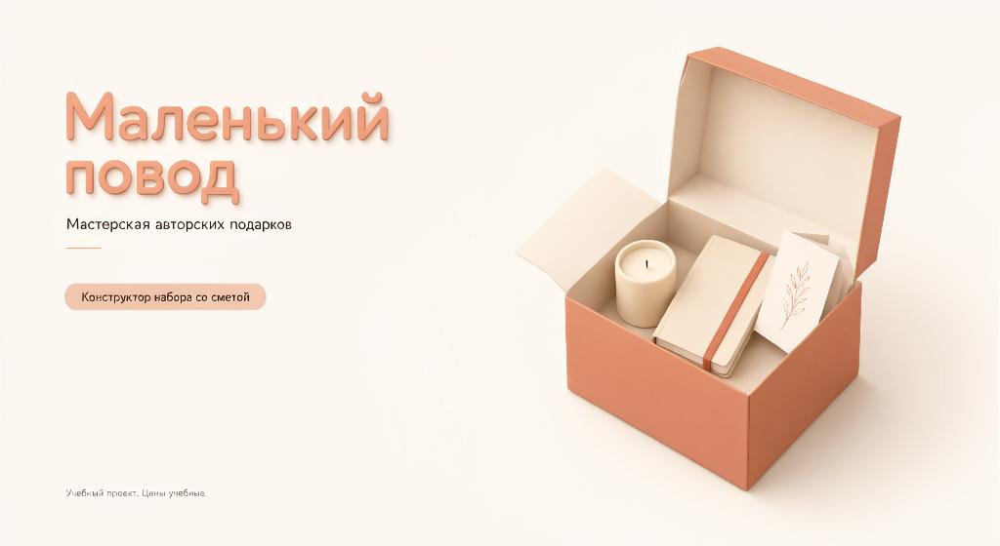
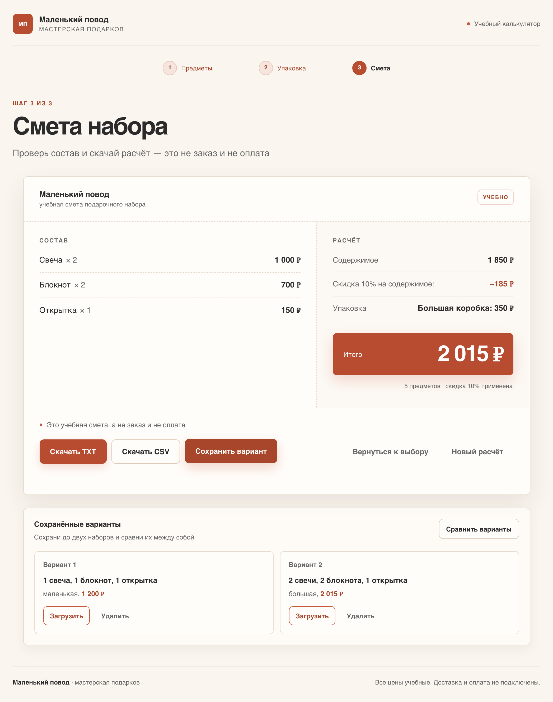
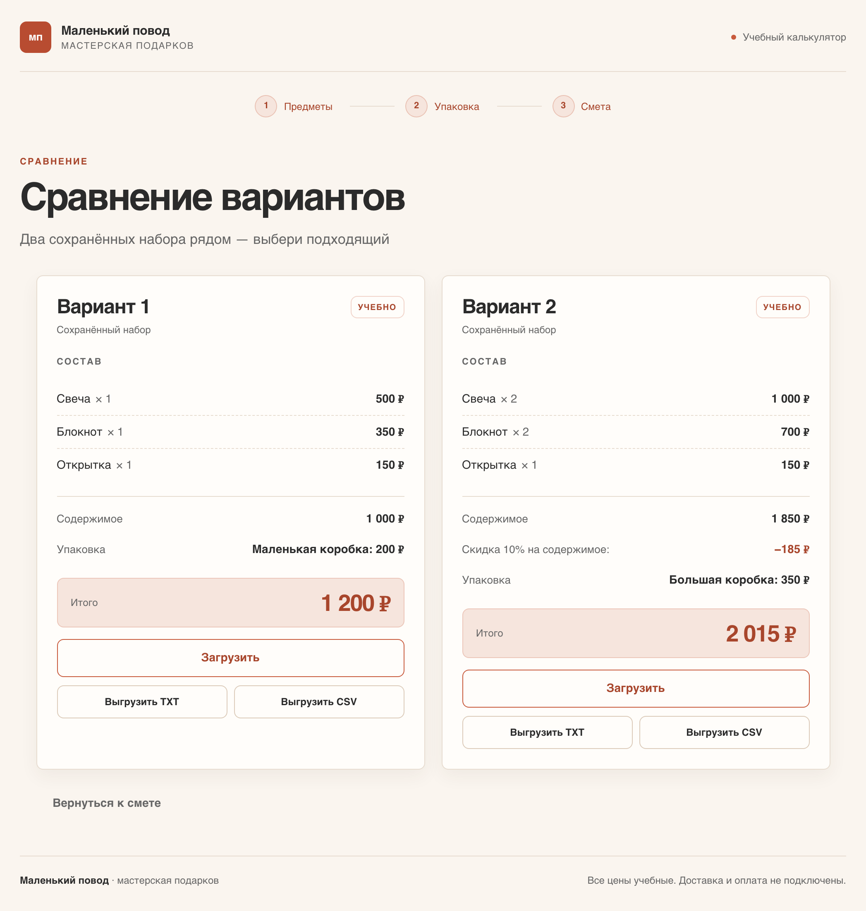
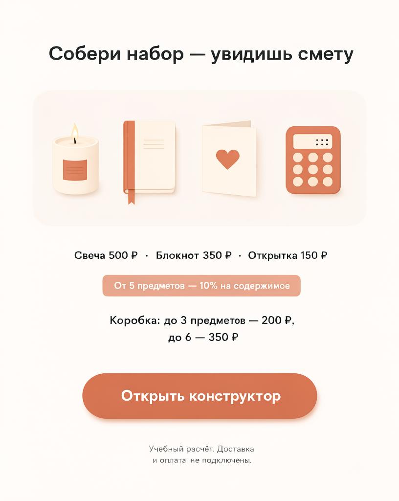
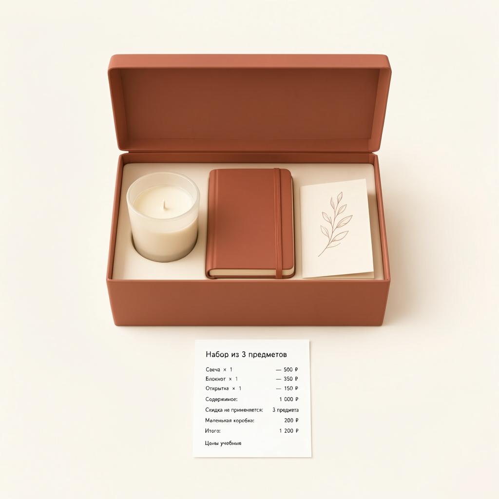
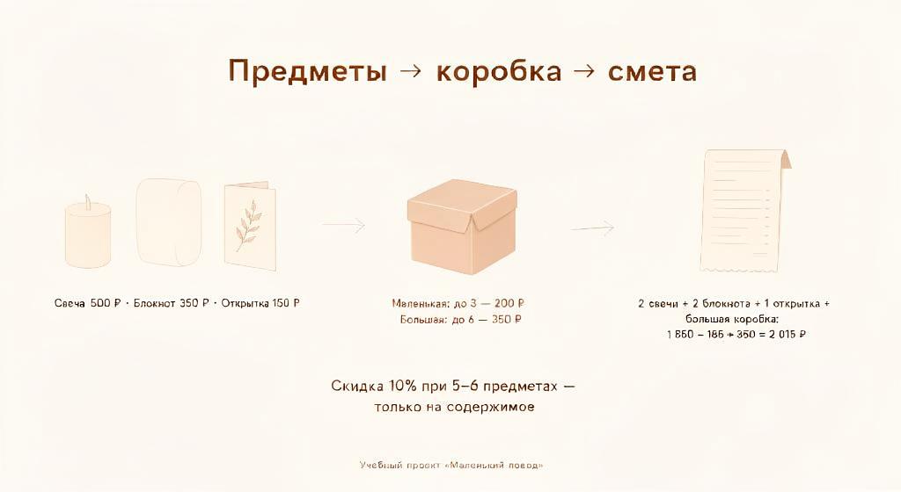
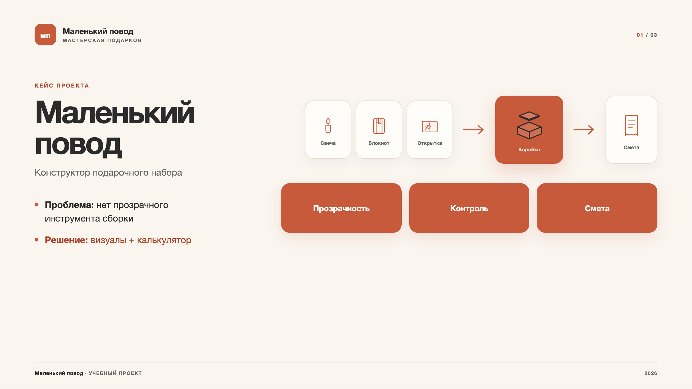
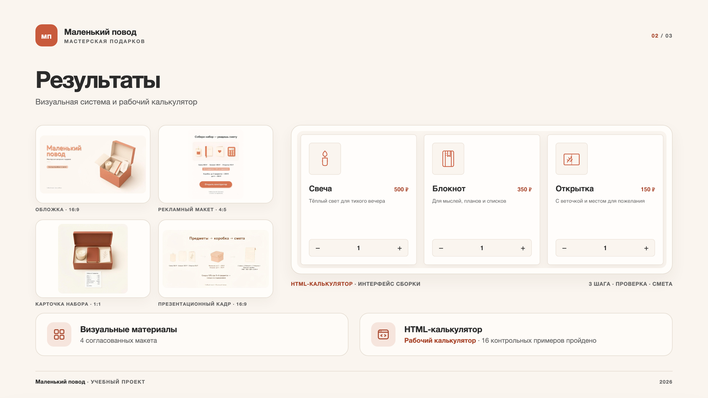
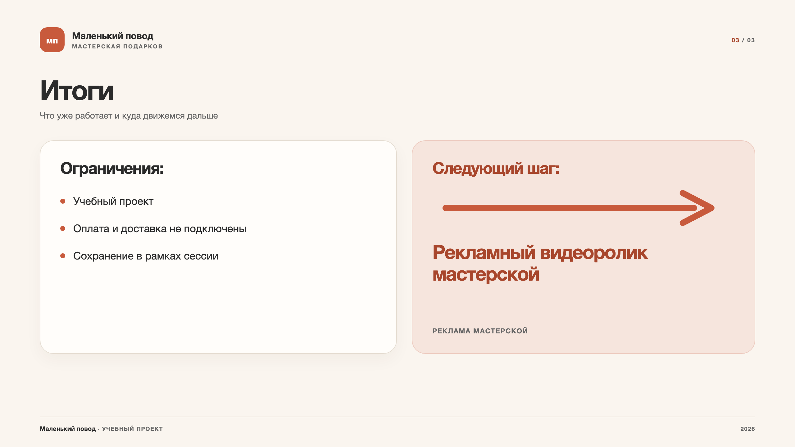

# Маленький повод — конструктор подарочного набора

**Учебный одностраничный калькулятор**, который помогает собрать подарочный набор, увидеть прозрачную смету и сравнить два варианта до выгрузки.

`HTML5` · `CSS3` · `Vanilla JavaScript` · `Single-file` · `No dependencies`



## Содержание

- [О проекте](#о-проекте)
- [Демо](#демо)
- [Возможности](#возможности)
- [Как считается смета](#как-считается-смета)
- [Сохранение и сравнение вариантов](#сохранение-и-сравнение-вариантов)
- [Визуальные материалы](#визуальные-материалы)
- [Презентация](#презентация)
- [Паспорт задачи](#паспорт-задачи)
- [Правила стиля](#правила-стиля)
- [Тексты интерфейса](#тексты-интерфейса)
- [Проверка](#проверка)
- [Структура проекта](#структура-проекта)
- [Запуск](#запуск)
- [Ограничения](#ограничения)

## О проекте

Мастерской «Маленький повод» требовался прозрачный инструмент для сборки учебного подарочного набора. Пользователю нужно было видеть, как количество предметов, размер коробки и скидка на содержимое влияют на итоговую смету — без подключения реальных оплаты и доставки.

Выбрана связка **мини-продукта и визуальных материалов**:

- HTML-калькулятор позволяет самостоятельно собрать набор, проверить логику расчёта и выгрузить смету.
- Четыре макета формируют единый образ бренда и объясняют механику до запуска инструмента.

Проект решает задачу прозрачности: пользователь видит отдельно содержимое, скидку и упаковку, получает понятную ошибку при превышении вместимости и скачивает состав, совпадающий со сметой.

### Что готово

- 4 согласованных визуальных макета: обложка (16:9), рекламный макет (4:5), карточка набора (1:1) и презентационный кадр (16:9).
- Рабочий HTML-калькулятор: один файл без внешних зависимостей, со встроенными SVG-иконками в стиле макетов.
- Дополнительная функция: сохранение двух вариантов набора для сравнения и раздельная выгрузка каждого в TXT и CSV.
- Документация: паспорт задачи, таблица условий, тексты интерфейса и правила стиля — в этом README.

## Демо

Приложение не требует сборки и внешних зависимостей: откройте `index.html` в браузере.

<p align="center">
  
</p>

<p align="center"><sub>Экран сметы: расчёт со скидкой, итоговая сумма и сохранённые варианты ниже сметы</sub></p>

### GitHub Pages

1. Разместите содержимое папки `little-reason-constructor` в корне репозитория.
2. Откройте **Settings → Pages**.
3. Выберите **Deploy from a branch**, ветку `main` и папку `/ (root)`.
4. После публикации приложение будет доступно по адресу вида `https://<username>.github.io/<repository>/`.

## Возможности

- Три шага сборки: **Предметы → Упаковка → Смета**.
- Свеча, блокнот и открытка: до 3 штук каждого вида.
- Ограничение 6 предметов на шаге 1: при превышении появляется предупреждение, кнопка «Выбрать коробку» блокируется. Когда предметов снова 6 или меньше, предупреждение исчезает, кнопка активируется.
- Автоматический подбор коробки по количеству предметов.
- Проверка вместимости: если предметов больше, чем помещается в выбранную коробку, итог не подтверждается.
- Скидка 10% на содержимое при 5–6 предметах; упаковка в скидке не участвует.
- Раздельный показ содержимого, скидки и упаковки.
- Сохранение двух вариантов набора в рамках сессии.
- Загрузка, удаление и замена сохранённых вариантов.
- Экран сравнения двух вариантов.
- Выгрузка текущей сметы и каждого варианта отдельно в **TXT** и **CSV**.
- Адаптивная вёрстка, клавиатурная навигация, `aria-live`-уведомления и поддержка `prefers-reduced-motion`.
- Один HTML-файл: стили, скрипты и SVG-иконки встроены в документ.

## Как считается смета

| Параметр | Правило |
|---|---|
| Предметы | Сумма количеств всех предметов |
| Количество одного вида | Целое число от 0 до 3 |
| Свеча | 500 ₽ |
| Блокнот | 350 ₽ |
| Открытка | 150 ₽ |
| Содержимое | Сумма «цена × количество» |
| Скидка | 10% на содержимое при 5–6 предметах |
| Маленькая коробка | До 3 предметов, 200 ₽ |
| Большая коробка | До 6 предметов, 350 ₽ |
| Итог | Содержимое после скидки + упаковка |

```text
Содержимое = Σ (цена × количество)
Скидка     = Содержимое × 0,1  при 5–6 предметах
Итог       = Содержимое − Скидка + Упаковка
```

Если вместимость выбранной коробки превышена, смета не подтверждается: пользователь видит пояснение и предложение убрать лишнее или выбрать другую коробку.

## Сохранение и сравнение вариантов

На экране сметы доступны два слота:

- **«Сохранить вариант»** — сохраняет текущий набор в первый свободный слот.
- Если оба слота заняты, открывается модальное окно с выбором: заменить вариант 1, заменить вариант 2 или отменить действие.
- Каждый слот показывает состав, размер коробки и итог, а также кнопки **«Загрузить»** и **«Удалить»**.
- **«Сравнить варианты»** активна только при двух заполненных слотах.

На экране сравнения два варианта показаны рядом на десктопе и друг под другом на мобильном. В каждой колонке есть состав, содержимое, скидка, упаковка, итог, кнопка **«Загрузить»** и собственные кнопки выгрузки **«Выгрузить TXT»** и **«Выгрузить CSV»**. Отсюда можно загрузить вариант обратно в калькулятор или скачать его отдельно:

- `smeta-variant-1.txt` / `smeta-variant-1.csv` — кнопки под вариантом 1;
- `smeta-variant-2.txt` / `smeta-variant-2.csv` — кнопки под вариантом 2;
- текущая смета через универсальные функции — `smeta-current.txt` / `smeta-current.csv`.

<p align="center">
  
</p>

<p align="center"><sub>Сравнение: 1 200 ₽ и 2 015 ₽, состав, скидка, упаковка и кнопки выгрузки под каждым вариантом</sub></p>

Сохранённые варианты хранятся в памяти браузера и не переживают перезагрузку страницы — это осознанное ограничение, чтобы сохранить принцип «одного HTML-файла» без бэкенда.

## Визуальные материалы

<table>
  <tr>
    <td width="50%" valign="top">
      
      <br><sub><b>Обложка</b> · 16:9</sub>
    </td>
    <td width="50%" valign="top">
      
      <br><sub><b>Рекламный макет</b> · 4:5</sub>
    </td>
  </tr>
  <tr>
    <td width="50%" valign="top">
      
      <br><sub><b>Карточка набора</b> · 1:1</sub>
    </td>
    <td width="50%" valign="top">
      
      <br><sub><b>Презентационный кадр</b> · 16:9</sub>
    </td>
  </tr>
</table>

Все макеты используют одну палитру, типографику и конструкцию предметов. Цифры на визуалах совпадают с контрольными расчётами: `1 200 ₽` для набора из трёх предметов и `2 015 ₽` для набора из пяти предметов с большой коробкой.

## Презентация

Три слайда 16:9 о проекте: проблема и выбранный формат, результаты, ограничения и следующий шаг. Слайды используют ту же палитру, типографику и иконки, что и калькулятор.

**[Скачать PDF →](presentation/little-reason-constructor-stage-1.pdf)** · 3 слайда, 16:9

<table>
  <tr>
    <td width="33.33%" valign="top">
      <a href="presentation/little-reason-constructor-stage-1.pdf"></a>
      <br><sub><b>01</b> · Проблема и формат</sub>
    </td>
    <td width="33.33%" valign="top">
      <a href="presentation/little-reason-constructor-stage-1.pdf"></a>
      <br><sub><b>02</b> · Результаты</sub>
    </td>
    <td width="33.33%" valign="top">
      <a href="presentation/little-reason-constructor-stage-1.pdf"></a>
      <br><sub><b>03</b> · Ограничения и следующий шаг</sub>
    </td>
  </tr>
</table>

Исходник слайдов — `presentation/slides.html`: его можно править и заново экспортировать в PDF. Скриншот интерфейса для второго слайда лежит в `presentation/assets/app-items.png`.

## Паспорт задачи

| Поле | Значение |
|---|---|
| **Пользователь** | Человек, собирающий учебный подарочный набор в мастерской «Маленький повод» |
| **Проблема** | Нет прозрачного инструмента сборки с учётом вместимости, количества и скидки |
| **Цель** | Позволить собрать набор и получить понятный расчёт со сметой |
| **Выбранный состав** | Тексты + мини-продукт (HTML) + 4 визуальных материала |
| **Критерий пользы** | Пользователь собирает допустимый набор, видит раздельно содержимое, скидку и упаковку, получает понятную ошибку при превышении вместимости и скачивает состав, совпадающий со сметой |

### Условия брифа

- Предметы = сумма количеств.
- Если вместимость выбранной коробки превышена, итог не подтверждается.
- Содержимое = сумма «цена × количество».
- При 5–6 предметах содержимое умножается на 0,9.
- Итог = содержимое после скидки + коробка.
- При изменении коробки проверяется уже введённое содержимое.
- Состав, скидка и упаковка показываются отдельно.

## Правила стиля

### Палитра

| Роль | Цвет |
|---|---|
| Фон | Кремовый `#FAF5EF` |
| Акцент | Терракотовый `#C85A3C` |
| Текст | Графит `#2B2B2B` |
| Линии и тени | Мягкий бежевый `#E5DDD2` |
| Вторичный текст | Серый `#666666` |

### Типографика

- Чистый гротеск: `Inter`, `Helvetica`, `SF Pro`.
- Заголовки: 28–36 px, полужирный.
- Основной текст: 16–18 px, регулярный.
- Сноски: 12 px, серый `#666666`.

### Конструкция предметов

- Минималистичный 3D-изометрический рендер или плоский вектор с мягкой тенью.
- Узнаваемые силуэты: свеча в стекле, блокнот в точку/линейку, классическая открытка.
- Без лишних деталей.

### Образ упаковки

- Единая форма крафтовой или матовой коробки.
- Маленькая коробка — компактный куб.
- Большая коробка — широкий прямоугольный параллелепипед.
- Крышка слегка приоткрыта, предметы «выглядывают».

### Композиция

- Много негативного пространства.
- Текст выровнен по сетке и не перекрывает ключевые визуальные элементы.

## Тексты интерфейса

| Контекст | Текст |
|---|---|
| Главный экран | «Собери свой набор» |
| Рекламный макет | «Собери набор — увидишь смету» |
| Переход к смете | «Проверь состав и скачай расчёт — это не заказ и не оплата» |
| Сохранение | «Сохранить вариант» |
| Уведомление | «Вариант 1 сохранён» / «Вариант 2 сохранён» |
| Оба слота заняты | «Оба слота заняты. Заменить вариант 1 или вариант 2?» |
| Действия в модальном окне | «Заменить 1» / «Заменить 2» / «Отмена» |
| Пустой слот | «Пусто» |
| Сравнение | «Сравнить варианты» / «Сравнение вариантов» |
| Возврат | «Вернуться к смете» |
| Ошибка количества | «Количество — целое число от 0 до 3» |
| Превышение лимита | «Одного вида может быть не больше 3» |
| Превышение общего лимита | «Максимум 6 предметов — убери лишние» |
| Дисклеймер | «Это учебная смета, а не заказ и не оплата» |

## Проверка

Пройдено **16 контрольных примеров**: 10 базовых из брифа и 6 сценариев новой функции.

| Код | Контрольный пример | Что проверялось | Ожидаемый результат | Фактический результат | Статус |
|---|---|---|---|---|---|
| К1 | 1 свеча + 1 блокнот + 1 открытка + маленькая коробка | Базовый расчёт без скидки | 500 + 350 + 150 + 200 = 1 200 ₽ | 1 200 ₽ | ✅ Пройден |
| К2 | 2 свечи + 2 блокнота + 1 открытка + большая коробка | Расчёт со скидкой 10% | 1 850 − 185 + 350 = 2 015 ₽ | 2 015 ₽ | ✅ Пройден |
| К3 | 4 предмета + маленькая коробка | Превышение вместимости | Ошибка, кнопка «Показать смету» заблокирована | Ошибка показана, кнопка заблокирована | ✅ Пройден |
| К3б | 4 предмета + большая коробка | Расчёт после смены коробки | Смета рассчитана корректно | Смета рассчитана | ✅ Пройден |
| К4 | 0 предметов | Валидация минимума | Кнопка «Выбрать коробку» неактивна | Кнопка неактивна | ✅ Пройден |
| К4б | Отрицательные значения | Валидация ввода | Кнопка «−» не уменьшает ниже 0 | Не уменьшается ниже 0 | ✅ Пройден |
| К4в | Дробные значения | Валидация ввода | Ввод дробных невозможен (только кнопки ±) | Только целые числа | ✅ Пройден |
| К4г | Больше 3 одного вида | Валидация максимума | Кнопка «+» не увеличивает выше 3 | Не увеличивается выше 3 | ✅ Пройден |
| К5 | Смена большой коробки на маленькую при 5 предметах | Повторная проверка вместимости | Ошибка, индикатор красный | Ошибка показана, индикатор красный | ✅ Пройден |
| К5б | Экспорт совпадает со сметой | Выгрузка TXT и CSV | Числа в файле = числам на экране | Числа совпадают | ✅ Пройден |
| А | Сохранение первого варианта (1 свеча + 1 блокнот + 1 открытка + маленькая = 1 200 ₽) | Кнопка «Сохранить вариант» | Слот 1 заполнен: «1 свеча, 1 блокнот, 1 открытка, маленькая, 1 200 ₽» | Слот 1 заполнен, уведомление «Вариант 1 сохранён» | ✅ Пройден |
| Б | Сохранение второго варианта (2 свечи + 2 блокнота + 1 открытка + большая = 2 015 ₽) | Второй слот + активация кнопки «Сравнить» | Слот 2 заполнен, кнопка «Сравнить варианты» активна | Слот 2 заполнен, кнопка «Сравнить» активна | ✅ Пройден |
| В | Загрузка варианта из слота | Кнопка «Загрузить» | Текущий набор = загруженный вариант, показана смета, счётчики обновлены | Счётчики обновлены, смета соответствует варианту | ✅ Пройден |
| Г | Выгрузка варианта с экрана сравнения | Кнопки «Выгрузить TXT» / «Выгрузить CSV» под каждым вариантом | Скачан файл smeta-variant-N.txt/.csv с корректными данными | Файл скачан, содержимое совпадает со сметой варианта | ✅ Пройден |
| Д | Замена занятого слота | Кнопка «Сохранить вариант» при двух заполненных слотах | Модальное окно: «Заменить 1» / «Заменить 2» / «Отмена» | Модальное окно показано, замена работает | ✅ Пройден |
| Е | Удаление слота | Кнопка «Удалить» | Слот пуст, кнопка «Сравнить варианты» неактивна | Слот очищен, кнопка «Сравнить» заблокирована | ✅ Пройден |

### Доработки после проверки

- Ограничение 6 предметов на шаге 1: при 7 и более предметах появляется предупреждение, кнопка «Выбрать коробку» блокируется; при возврате к 6 и меньше предупреждение исчезает, кнопка снова активна.
- Блок «Сохранённые варианты» расположен ниже основной сметы.
- Кнопки выгрузки TXT и CSV находятся в карточке соответствующего варианта.

### Сравнение вариантов

После базовой версии добавлена одна осмысленная функция — сохранение и сравнение двух вариантов набора. После внедрения все 10 старых контрольных примеров пройдены повторно: регрессий нет, существующие расчёты, экраны и выгрузки работают как раньше.

Дополнительно проверено:

- все 10 базовых сценариев повторно пройдены после внедрения сравнения — регрессий нет;
- форматы TXT и CSV совпадают с исходной логикой;
- существующие кнопки текущей выгрузки и их имена файлов не изменены;
- адаптивная раскладка при ширине `390 px`: колонки сравнительного экрана перестраиваются в одну, горизонтальной прокрутки нет;
- Lighthouse: **Accessibility 100**, **Best Practices 100**, **SEO 100**;
- ошибок в консоли браузера нет.

Визуальные макеты проверены по чек-листу: тексты читаются, цифры совпадают с брифом, палитра и конструкция предметов унифицированы.

## Структура проекта

```text
little-reason-constructor/
├── index.html                  # калькулятор: HTML + CSS + JS + SVG
├── README.md
├── images/
│   ├── cover.png               # обложка 16:9
│   ├── ad-layout.png           # рекламный макет 4:5
│   ├── set-card.png            # карточка набора 1:1
│   ├── presentation-frame.png  # презентационный кадр 16:9
│   ├── app-estimate.png        # скриншот экрана сметы
│   └── app-compare.png         # скриншот сравнения вариантов
└── presentation/
    ├── little-reason-constructor-stage-1.pdf  # презентация, 3 слайда 16:9
    ├── slides.html             # исходник слайдов и print-стили
    ├── assets/
    │   └── app-items.png       # скриншот карточек для слайда 2
    └── preview/
        ├── slide-1.png         # превью слайда 1
        ├── slide-2.png         # превью слайда 2
        └── slide-3.png         # превью слайда 3
```

## Запуск

### Локально

Откройте `index.html` двойным щелчком — приложение работает без сборки и сервера.

Если нужен локальный HTTP-сервер:

```bash
cd little-reason-constructor
python3 -m http.server 8000
```

Затем откройте `http://localhost:8000`.

### Публикация

Для GitHub Pages достаточно разместить `index.html` в корне репозитория и включить публикацию из ветки `main`, папка `/ (root)`.

## Ограничения

- Проект **учебный**: оплата, доставка и отправка заказа не подключены согласно брифу.
- Сохранение вариантов работает **в рамках одной сессии** — без бэкенда и без сохранения после перезагрузки страницы.
- Все цены и скидки демонстрационные.
- Приложение не собирает персональные данные и не отправляет их на сервер.

---

Учебный проект мастерской «Маленький повод». Цены и сценарии использования — демонстрационные.
